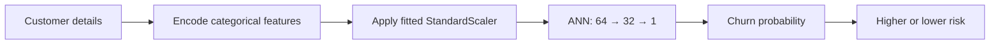

# Bank Customer Churn Prediction

### Artificial Neural Network (ANN) · Interactive Streamlit Application

[](https://www.python.org/)
[](https://www.tensorflow.org/)
[](https://scikit-learn.org/)
[](https://streamlit.io/)

An end-to-end deep learning project that estimates **the likelihood of a bank customer leaving** using demographic, financial, and account information. It combines a TensorFlow/Keras neural network with reusable scikit-learn preprocessing and an interactive Streamlit interface.

**[🚀 Live Demo](https://ann-churn-prediction-irscqzbgqozp6qpul4kveb.streamlit.app/)** · **[Explore the Code](https://github.com/iiitianrajan/ANN-Churn-Prediction)** · **[Training Notebook](https://github.com/iiitianrajan/ANN-Churn-Prediction/blob/main/experiments.ipynb)** · **[Inference Notebook](https://github.com/iiitianrajan/ANN-Churn-Prediction/blob/main/prediction.ipynb)**

---

## Project Highlights

- **End-to-end ML workflow:** Customer data → feature encoding → scaling → ANN training → saved artifacts → web-based inference.
- **Neural network classifier:** A feed-forward ANN with 64- and 32-neuron hidden layers and a sigmoid output.
- **Interactive prediction:** Enter customer information to view an estimated churn probability and risk classification.
- **Reusable inference pipeline:** Loads the trained model, fitted encoders, and scaler rather than refitting preprocessing on new inputs.
- **Inspectable results:** The application displays the transformed model-input features alongside the prediction.

## At a Glance

| Item | Details |
|---|---|
| **Use case** | Customer churn prediction for banking |
| **Task** | Binary classification (`Exited`: `0` = retained, `1` = churned) |
| **Dataset** | `Churn_Modelling.csv` · 10,000 customer records |
| **Model** | Dense ANN: 12 encoded inputs → 64 (ReLU) → 32 (ReLU) → 1 (Sigmoid) |
| **Preprocessing** | Label encoding, one-hot encoding, standardization |
| **Recorded validation accuracy** | **86.8%** (final recorded epoch in the training notebook) |
| **Interface** | Streamlit dashboard, deployed online |

> **Evaluation note:** The 86.8% figure is a notebook validation result on the 20% holdout used during training/early-stopping monitoring. It is **not** presented as an independently evaluated test-set score or a production performance guarantee.

## Quick Start

**Prerequisites:** Python 3.12, Git, and pip.

```bash
# 1. Clone the project
git clone https://github.com/iiitianrajan/ANN-Churn-Prediction.git
cd ANN-Churn-Prediction

# 2. Create a virtual environment
python -m venv .venv

# 3. Activate it
# Windows (PowerShell):
.venv\Scripts\Activate.ps1

# Windows (Command Prompt):
.venv\Scripts\activate.bat

# macOS / Linux:
source .venv/bin/activate

# 4. Install dependencies
python -m pip install -r requirements.txt

# 5. Start the application
python -m streamlit run app.py
```

Open **http://localhost:8501** in your browser. The repository includes the trained model and preprocessing artifacts required by `app.py`.

## How It Works



1. The user enters customer details through a Streamlit form.
2. The application applies the saved **gender label encoder** and **geography one-hot encoder**.
3. The encoded features are aligned to the training feature order and transformed using the saved **StandardScaler**.
4. The TensorFlow/Keras model returns an estimated churn probability between 0 and 1.
5. The dashboard displays the probability, a visual indicator, and a risk interpretation based on a **0.50 threshold**.

| Estimated probability | Application output |
|---|---|
| Below 50% | **Lower churn risk** |
| 50% or above | **Higher churn risk** |

The result is a model estimate, **not** a calibrated probability guarantee or a recommendation for an individual banking decision.

## Dataset and Features

The project uses the `Churn_Modelling.csv` banking churn dataset included in the repository. Its target, **`Exited`**, indicates whether a customer left the bank.

| Feature group | Model inputs |
|---|---|
| **Customer profile** | `CreditScore`, `Geography`, `Gender`, `Age` |
| **Banking relationship** | `Tenure`, `NumOfProducts`, `HasCrCard`, `IsActiveMember` |
| **Financial information** | `Balance`, `EstimatedSalary` |
| **Prediction target** | `Exited` (0 = stayed, 1 = left) |

After encoding `Geography` into three indicator columns, the ANN receives **12 numerical inputs**. Identifiers such as customer ID and surname are not included as predictive features.

## Model Development

The training workflow is documented in [`experiments.ipynb`](experiments.ipynb).

| Component | Implementation |
|---|---|
| Train/holdout split | 80% / 20% (`random_state=42`) |
| Categorical preprocessing | `LabelEncoder` for gender; `OneHotEncoder` for geography |
| Feature normalization | `StandardScaler` fitted on the training data |
| Architecture | `Dense(64, ReLU)` → `Dense(32, ReLU)` → `Dense(1, Sigmoid)` |
| Optimizer | Adam |
| Loss function | Binary cross-entropy |
| Tracked metric | Accuracy |
| Training controls | Early stopping and TensorBoard callbacks |
| Serialization | Keras `.h5` model and pickle `.pkl` preprocessing files |

The notebook records a **validation accuracy of 86.8%** at its final logged epoch. For a stronger evaluation, the next step is to report precision, recall, F1-score, ROC-AUC, and confusion matrix results on a **separate, untouched test set**.

## Application Features

- Input form for customer profile, account activity, and financial attributes.
- Churn probability displayed as a percentage and progress bar.
- Clear higher/lower risk interpretation using the 50% decision threshold.
- Expandable view of encoded features passed to the preprocessing pipeline.
- Model architecture and parameter information obtained from the loaded model.
- Error handling for missing model artifacts and prediction failures.

## Repository Structure

```text
ANN-Churn-Prediction/
├── app.py                    # Streamlit prediction dashboard
├── experiments.ipynb         # Data preprocessing, ANN training, validation
├── prediction.ipynb          # Example inference workflow
├── Churn_Modelling.csv       # Customer churn dataset
├── model.h5                  # Saved Keras ANN model
├── label_encoder_gender.pkl  # Fitted gender encoder
├── onehot_encoder_geo.pkl    # Fitted geography encoder
├── scaler.pkl                # Fitted feature scaler
├── requirements.txt          # Python dependencies
├── .gitignore
└── README.md
```

**Important:** Keep `model.h5` and the three `.pkl` files alongside `app.py`. Loading the saved preprocessing objects is necessary to reproduce the feature transformations used during training. Only load pickle files from sources you trust.

## Technology Stack

| Area | Tools |
|---|---|
| Programming and data | Python, Pandas, NumPy |
| Deep learning | TensorFlow, Keras |
| Preprocessing and evaluation | scikit-learn |
| User interface | Streamlit |
| Experimentation | Jupyter Notebook, TensorBoard, Matplotlib |
| Version control | Git, GitHub |

## Potential Improvements

- Evaluate on an untouched test set with class-aware metrics and a confusion matrix.
- Compare the ANN with interpretable baselines such as logistic regression and tree-based models.
- Add model explanations with SHAP and assess probability calibration.
- Pin dependency versions and add automated tests for the inference pipeline.

## Responsible Use

This repository is an **educational and portfolio project**. It uses historical customer attributes, including demographic fields, to estimate churn. Predictions may reflect dataset limitations or bias and should not be the sole basis of banking, lending, or customer-treatment decisions.

## Author

**Rajan Kumar** · B.Tech, Computer Science and Engineering

[GitHub](https://github.com/iiitianrajan) · [Project Repository](https://github.com/iiitianrajan/ANN-Churn-Prediction) · [Live Application](https://ann-churn-prediction-irscqzbgqozp6qpul4kveb.streamlit.app/)

---

*Built with Python, TensorFlow/Keras, scikit-learn, and Streamlit.*
